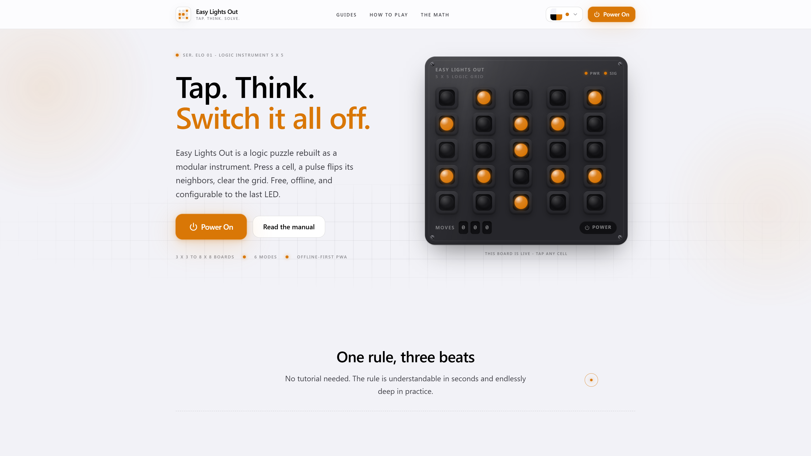
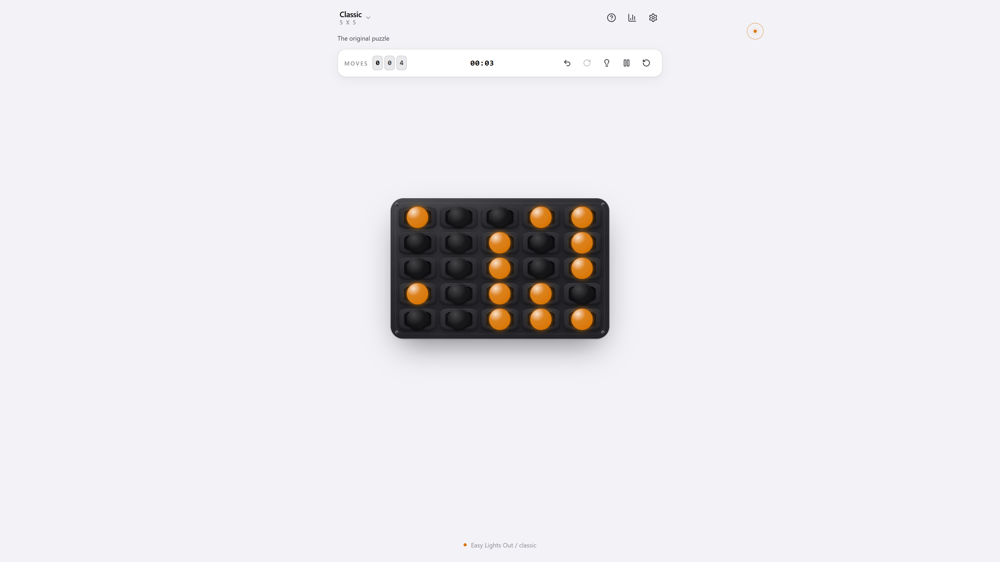
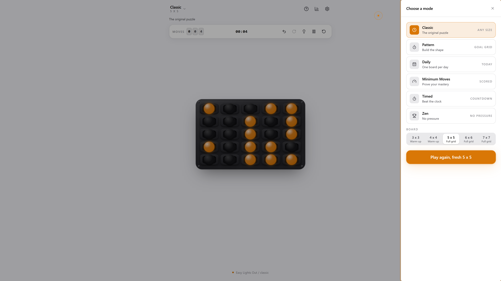
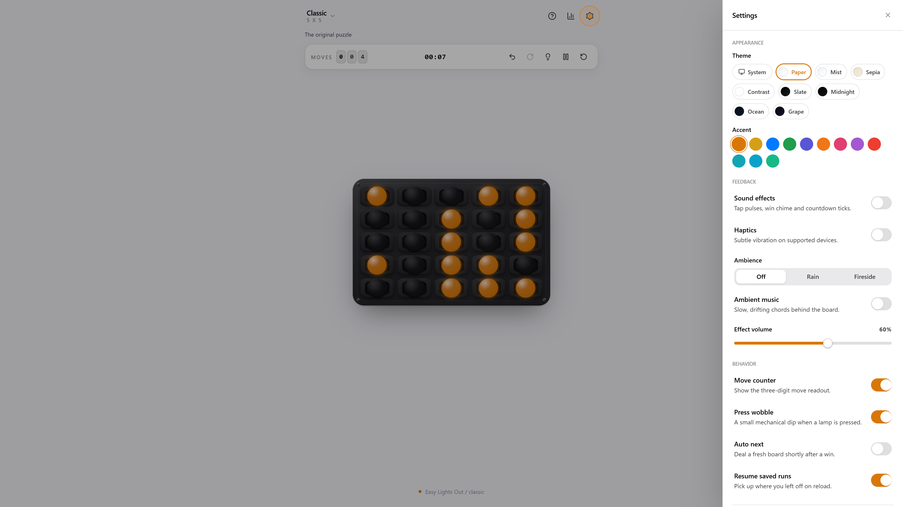
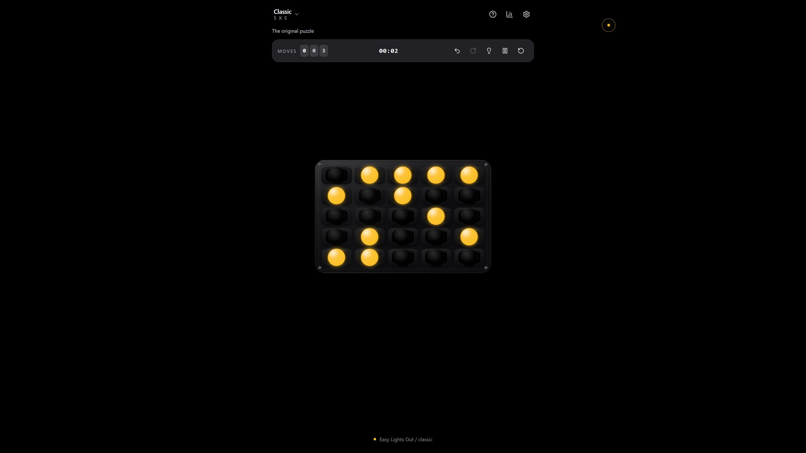
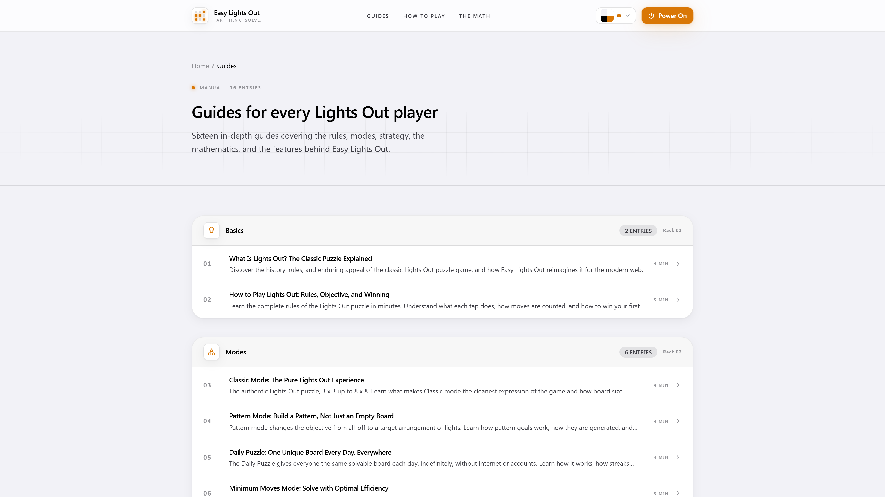
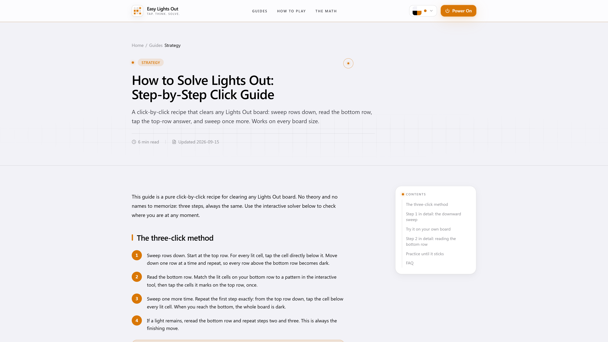
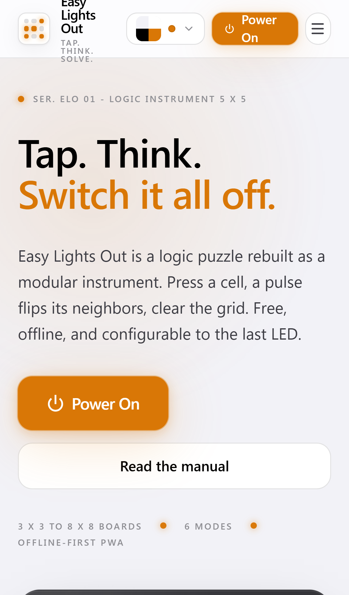
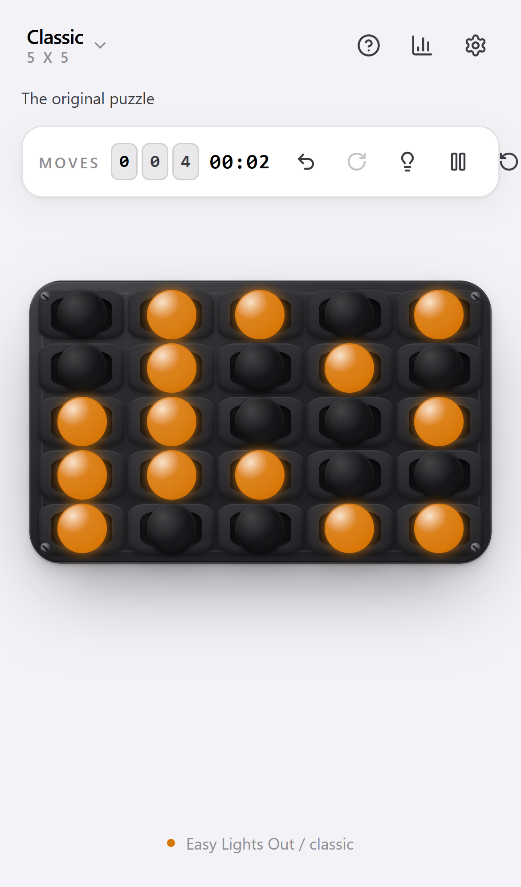
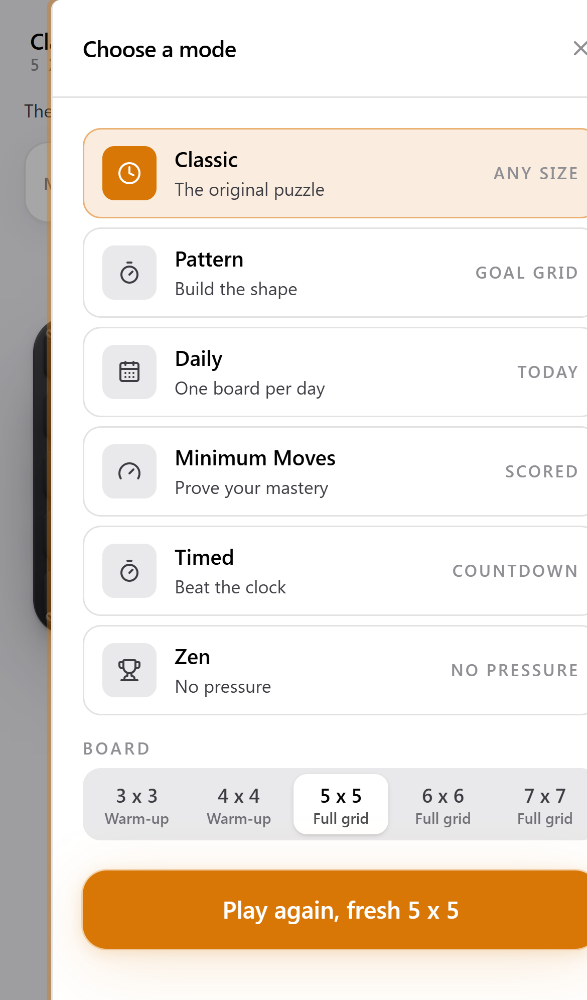

# Easy Lights Out

A beautifully crafted, offline-ready Lights Out puzzle built with Next.js and
Tailwind CSS. Tap a cell to flip it and its neighbours, then solve every board
in as few moves as possible - in six modes, on eight themes, with twelve
accents, installable as a PWA.

> Lights Out is a classic logic puzzle: every cell you press toggles itself and
> its four orthogonal neighbours. Turn every light off to win. That one rule is
> harder than it looks - the game plays like a modular synth instrument, so the
> grid is a patch bay of glowing LED cells.

## Screenshots

One viewport frame per capture, desktop and mobile (regenerate any time with
`node scripts/shots.mjs`).

### Desktop

| Landing | Gameplay (Classic 5x5, mid-run) | Gameplay (mode sheet) |
|---|---|---|
|  |  |  |

| Settings sheet | Midnight theme | Guides index | Solver guide |
|---|---|---|---|
|  |  |  |  |

### Mobile

| Landing | Gameplay | Mode sheet |
|---|---|---|
|  |  |  |

## Features

- Six modes: Classic, Pattern, Daily, Minimum Moves, Timed and Zen. Daily is
  deterministic - the same seeded 5x5 for everyone, every day, no server.
- A real solver engine (GF(2) / BigInt): boards are guaranteed solvable, the
  optimal move count is displayed, and hints are cross-checked at press time.
- Competitive modes (Daily, Minimum Moves, Timed) record stats; using undo or a
  hint keeps the run off the leaderboards.
- Statistics: per-mode totals and bests, a 7-day grid, and a daily streak
  counter.
- Custom command palette (Cmd/Ctrl+K), board context menu, toasts, and a brand
  cursor.
- Eight `data-theme` surfaces with twelve accent colours, themable at runtime
  with no flash on load.
- Progressive Web App: installable and fully offline, with keyboard shortcuts
  and screen-reader announcements.
- 16 in-app guides, including an interactive solver tool
  (`/guides/how-to-solve-lights-out`) built on the same engine the game uses.

## Tech stack

- Next.js 16 (App Router, Turbopack, static prerender)
- React 19
- Tailwind CSS v4 (token system: `@theme inline`)
- Zustand (state; engine mutations drive renders via a revision counter)
- Framer Motion (`motion/react`) for springs and scroll effects
- Vitest (83 unit tests across 8 suites)
- TypeScript (strict)

## Getting started

```bash
pnpm install
pnpm dev
```

Open [http://localhost:3000](http://localhost:3000).

## Scripts

| Command | Description |
|---|---|
| `pnpm dev` | Development server |
| `pnpm build` | Production build |
| `pnpm start` | Serve production build |
| `pnpm test` | Run Vitest unit tests |
| `pnpm exec tsc --noEmit` | Type check |
| `pnpm exec eslint .` | Lint |
| `node scripts/shots.mjs` | Regenerate `docs/screenshots` |

## Project structure

```
src/
  engine/      Puzzle math: GF(2) solver, generator, modes, chase helper
  game/        Zustand stores, persistence, stats, audio
  components/  UI primitives, game scene, guides, landing, theme, layout, PWA
  app/         Pages, metadata, CSS
  lib/         Guide registry, SEO, site config
rules/         Internal planning docs (gitignored)
```

## Documentation

- [docs/ARCHITECTURE.md](docs/ARCHITECTURE.md) - layers, state model, data flow,
  theming, PWA, testing strategy.
- [docs/ENGINE.md](docs/ENGINE.md) - the Lights Out math: GF(2) solving, board
  generation, deterministic RNG, chase.
- [docs/DEVELOPMENT.md](docs/DEVELOPMENT.md) - setup, conventions, common tasks,
  quality gate, known gotchas.
- [CONTRIBUTING.md](CONTRIBUTING.md) - how to report issues and open pull
  requests (bug and feature templates ship with the repo).

## Contributing

Contributions are welcome. See [CONTRIBUTING.md](CONTRIBUTING.md) and
[.github/ISSUE_TEMPLATE](.github/ISSUE_TEMPLATE). Before you start, read
`docs/DEVELOPMENT.md` - the quality gate (typecheck, lint, tests, build,
detector) is expected to pass on every pull request.

## License

Proprietary. See [LICENSE](LICENSE) for details. The code is available to read,
run locally, and send pull requests against, but distributing it requires
permission.

## Author

Arun Neupane - [arunneupane.vercel.app](https://arunneupane.vercel.app) |
[GitHub](https://github.com/arundada9000)